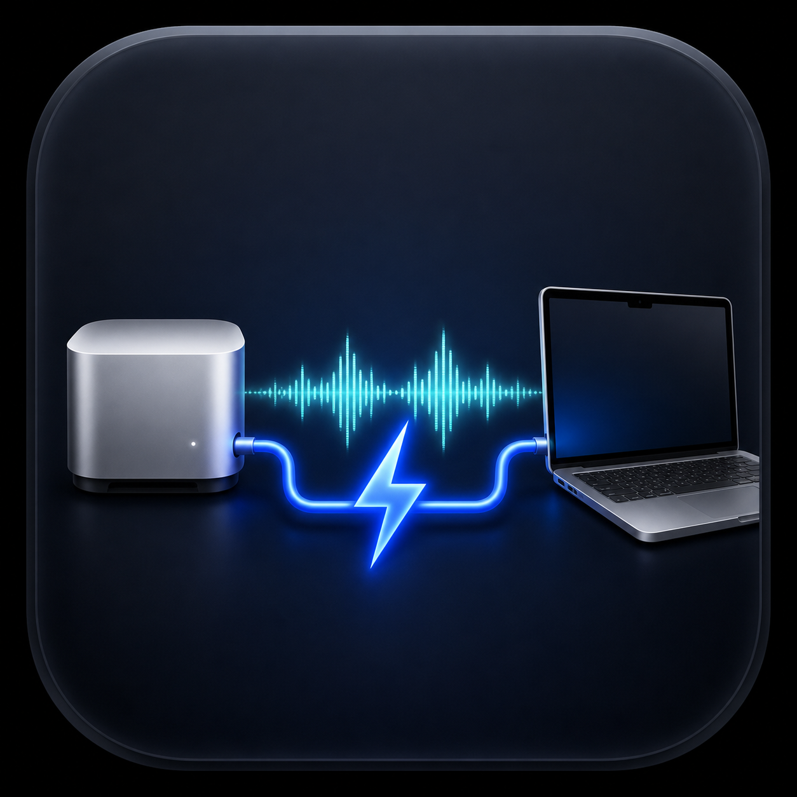

<p align="center">
  
</p>

# macOS Audio Forward

macOS Audio Forward is a native menu-bar app that sends live system audio between two Macs over a direct Thunderbolt Bridge. Install the same app on both Macs, choose the other Mac, and the sender temporarily appears as an output named after the receiver—for example, **Mac Studio via Thunderbolt**.

It is designed for a MacBook and desktop Mac that already share a Thunderbolt network link. It does not use AirPlay, so Universal Control can remain available for linked keyboard and mouse use.

## Features

- Two-way operation: either Mac can send and either Mac can receive
- Automatic peer discovery limited to the `bridge0` Thunderbolt interface
- A temporary named Core Audio output while forwarding is active
- Received sound follows the destination Mac's current output device
- Low-latency stereo PCM transport with buffering and clock-drift correction
- Automatic restoration of the sender's previous output when forwarding stops
- Optional Launch at Login using Apple's `SMAppService`
- Native Swift/AppKit/SwiftUI app with no third-party dependencies
- No accounts, cloud service, analytics, or internet connection

## Requirements

- Two Apple Silicon Macs running macOS 26 Tahoe or later
- A direct Thunderbolt cable between the Macs
- Thunderbolt Bridge enabled in **System Settings → Network** on both Macs

Version 0.1.1 is an Apple Silicon preview build. Intel Macs and older macOS releases are not currently supported.

## Install

Install the app on both Macs:

1. Download the latest `macOS-Audio-Forward` ZIP from Releases.
2. Unzip it and move **macOS Audio Forward.app** into `/Applications` on each Mac.
3. Open the app on both Macs. Its control panel opens immediately and an **Audio** control remains in each menu bar after the panel closes.
4. The first time you send, allow **System Audio Recording** when macOS asks.
5. On the sending Mac, open the menu and click **Send Audio** beside the destination Mac.

### Bartender 6

Audio Forward gives its status item a stable identity and label so Bartender can index it consistently. When Bartender 6 is running, clicking **Audio** from the Bartender Bar, a group, or Quick Search opens a standalone control panel instead of trying to anchor a popover to the hidden original item. You can place **Audio** in Bartender's **Always Shown**, **Hidden**, or grouped section; forwarding behavior is unchanged.

Opening **macOS Audio Forward.app** again from `/Applications` always brings the control panel back, even when Bartender has hidden the menu-bar item.

The sender's default output changes to a temporary output named `<destination> via Thunderbolt`. Stopping the stream, quitting the app, or losing the connection restores the previous output. The receiving Mac plays the stream through whichever output it currently uses.

The preview archive is ad-hoc signed because the project does not yet have an Apple Developer ID certificate. macOS may require you to Control-click the app, choose **Open**, then confirm once.

## How it works

The app uses macOS's public Core Audio process-tap API to capture system output. While sending, it creates a temporary aggregate audio device containing the current physical output and the tap, makes that device the default, and uses `mutedWhenTapped` so playback is forwarded instead of duplicated locally. No virtual-audio driver, system extension, privileged helper, or reboot is required.

The two app instances advertise and discover a Bonjour service. Discovery, outgoing connections, and accepted incoming connections are all checked against the `bridge0` interface. Audio is transported as 32-bit floating-point stereo PCM over TCP with a small receiver buffer and bounded clock-rate correction.

Because it uses Thunderbolt networking instead of AirPlay, it does not take over the Continuity/AirPlay session used by Universal Control.

## Build

Only the Xcode Command Line Tools and macOS 26 SDK are required:

```sh
./scripts/check.sh
./scripts/build.sh
```

The app bundle is written to `build/macOS Audio Forward.app`. Install the local build with:

```sh
./scripts/install.sh
```

Create the release archive and SHA-256 checksum with:

```sh
./scripts/package-release.sh
```

## Known limitations

- The current release carries stereo system audio only; microphone forwarding is not included.
- Audio is uncompressed and intended for a direct Thunderbolt Bridge, not ordinary Wi-Fi or routed networks.
- The first send from each Mac requires macOS System Audio Recording permission.
- An abrupt system crash or forced power-off can leave a temporary aggregate device behind. The app removes its stale devices at the next launch.
- This preview is ad-hoc signed and not notarized.

## Uninstall

Turn off **Launch at Login**, quit the app on both Macs, and move it from `/Applications` to the Trash. Preferences can be removed with:

```sh
defaults delete dev.rallen.macos-audio-forward
```

## Distribution

Local builds are ad-hoc signed. For a trusted public distribution, install a valid **Developer ID Application** certificate and build with:

```sh
SIGN_IDENTITY="Developer ID Application: Your Name (TEAMID)" ./scripts/package-release.sh
```

Submit the archive with Apple's `notarytool`, staple the accepted ticket to the app, and recreate the archive before publishing. Signing credentials and notarization profiles must never be committed.

## Privacy and security

Captured audio is sent only while the user has an active forwarding session. The app accepts and initiates streams only through the Thunderbolt Bridge interface. It does not record audio to disk or send analytics. The direct-link stream is not encrypted, so do not route `bridge0` through an untrusted network. See [PRIVACY.md](PRIVACY.md) and [SECURITY.md](SECURITY.md).

## Project provenance

This is an independent implementation built from scratch with public Apple APIs. The app icon is original artwork generated specifically for this project.

## Contributing

Bug reports and focused pull requests are welcome. Read [CONTRIBUTING.md](CONTRIBUTING.md) before contributing.

## License

MIT © 2026 Ryan Allen. See [LICENSE](LICENSE).
